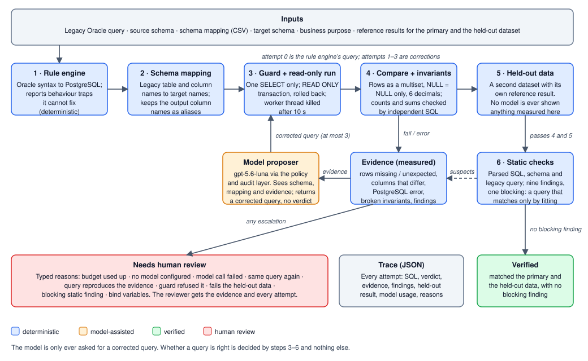

# QueryShift final submission (DRAFT: see "Before submitting" at the end)

## Team and contract

- Team name: **TO FILL**
- Members and roles: **TO FILL**
- Repository: https://github.com/swsarancodes/goforge
- Final commit/tag: **TO FILL** (tag the commit that is submitted, then repeat the run instructions below from a fresh `git clone` of that tag)
- Approved use-case contract: [docs/queryshift-contract.md](docs/queryshift-contract.md). Organizer decision: **pending**.

## Business outcome

- Domain and intended user: retail insurance. A data engineer migrating reporting queries from an Oracle warehouse to PostgreSQL, and the reviewer who signs the result off.
- Source platform: Oracle (SQL; no PL/SQL).
- Target platform: PostgreSQL.
- Modernization value: legacy Oracle reporting SQL uses constructs whose PostgreSQL look-alikes run without error and return different answers. A converted query that merely executes is treated as done. This workflow only calls a query converted when it reproduces a reference result on two datasets, and otherwise says why a person has to look at it, with the evidence.

## Run instructions

Node 24 (developed on 24.19.0, macOS). No Docker, no database server and no model key are needed for the deterministic parts: the target is PostgreSQL itself running in-process (PGlite).

```bash
git clone https://github.com/swsarancodes/goforge && cd goforge
npm install
npm install --prefix server

npm run queryshift                  # every known candidate judged on both datasets (19 candidates, 3 cases)
npm run queryshift -- --loop        # rule engine -> mapping -> correction loop, no model: verified or needs_human_review
npm run queryshift -- --loop --proposer replay   # the same, with the model answers recorded on 22 Oct played back (no key, no network)
npx vitest run queryshift server/src/ai    # 269 tests (207 harness, 62 for the AI layer)
```

`--proposer replay` calls no model. It reads the corrections recorded in `queryshift/reports/*.loop.json` and judges every query again, live, on both datasets; each replayed attempt is labelled `replay of the recorded gpt-5.6-luna, not a live call`. It shows that the checks accept the recorded answers, not that a model gives them today.

With a model (synthetic data only is sent; see Safety). Put the key in `server/.env`, which is gitignored:

```bash
echo 'OPENAI_API_KEY=...' >> server/.env
npm run queryshift:check-model                                    # one request in the real correction shape
npm run queryshift -- --loop --proposer model --out queryshift/reports   # writes <case>.loop.json (trace) and <case>.report.md (validation report)
```

Other commands: `npm run queryshift -- --engine --show-sql` (what GoForge's rule engine alone makes of each query), `--case <dir> --candidate <file.sql>` (judge one query), `--report-from <dir>` (write the Markdown reports from traces already on disk; runs nothing), `--replay-from <dir>`, `--timeout-ms`, `--max-corrections`, `--json`. More in [queryshift/README.md](queryshift/README.md). The demo script is [docs/queryshift-demo.md](docs/queryshift-demo.md).

**Checked from a fresh `git clone`** of the working branch at commit `4ac5e82` (committed files only: no `node_modules`, no `server/.env`; the next commit only edits this file), on the author's machine (macOS, Node 24.19.0, npm 11.17.0), 25 Oct 2026. Over two clones one commit apart: `npm install` and `npm install --prefix server` finish in 11 to 17 s and 2 to 3 s with npm's download cache warm (about 70 s on a cold cache, measured on 22 Oct); `npm run queryshift` takes 5 to 8 s, `--loop` 5 to 6 s, `--loop --proposer replay` 4 to 7 s; the 269 tests pass in 12 to 22 s (times vary with machine load); `--report-from queryshift/reports` leaves the three committed reports unchanged, byte for byte. The clones were made from the local repository, not from GitHub, so repeat this from the final tag (see the checklist at the end). Not run on another machine, OS or Node version.

Notes from that run:

- Use `npm install`, not `npm ci`. The root `package-lock.json` is behind `package.json` (the repository's CI installs with bun from `bun.lock`), so `npm ci` stops with "Missing: @dbml/core@10.3.1 from lock file", and `npm install` rewrites `package-lock.json`; that change is not part of the submission.
- npm 11 prints "install scripts not yet covered by allowScripts" (at the root `@swc/core`, `esbuild`, `fsevents`, `wa-sqlite`; in `server/` `better-sqlite3`, `esbuild`, `fsevents`, `oracledb`) and skips them. The harness and its tests do not need them and pass. The GoForge web app and its SQLite local mode were not exercised in the fresh copy and may need `npm approve-scripts`.
- Without a key, `queryshift:check-model` says "Not ready: No OpenAI API key is set", and `--loop --proposer model` ends in `needs_human_review` with reason `proposer_failed` and that message. With an invalid key both report OpenAI's 401 without printing the key. (The wording mentions restarting the API, which is the web app's wording.) `queryshift:check-model` was checked with a real, a blank and an invalid key.
- `--candidate` exits 1 for a query that does not pass on both datasets and 0 for one that does; `--loop` exits 1 while any case needs a human.

## Architecture



- **Data flow.** A case is a folder: legacy query, source and target schema, a column mapping, two seeded datasets (primary and held-out) with a hand-derived reference result each, invariants written as independent SQL, the values of any bind variables the legacy query has (`bindValues`; they are written into the query, so the reference result belongs to known values), and a set of candidate translations. The loop starts from the rule engine's conversion, renames it to the target schema, and runs it.
- **Model-assisted decisions.** Only one: given a query that failed, the measured evidence and the static findings, propose a corrected query with an explanation and its own stated doubts. GPT-5.6-luna through GoForge's AI layer (workspace policy check, audit log with exactly what was sent, structured outputs).
- **Deterministic tools and checks.**
  1. *Rule engine* (pre-existing, see Reused components): Oracle syntax conversion and behaviour traps.
  2. *Schema mapping rename* from `schema_mapping.csv` on the parsed tokens, keeping output column names as aliases; an ambiguous name is reported, never guessed.
  3. *Guard + runner:* one SELECT only; no writes, locks, settings, file access, `dblink`, `pg_sleep`, row locking; `READ ONLY` transaction, always rolled back; a 10,000-row cap; a worker thread that is terminated after 10 s.
  4. *Comparator:* the challenge defaults (row order ignored unless the case says otherwise, duplicates kept, NULL equals NULL only, numbers to 6 decimals), compared as PostgreSQL's column types; a timestamp keeps its time of day. All three cases say otherwise (`orderSensitive`; each legacy query has a total `ORDER BY`), so the right rows in the wrong order fail: every case has a `reversed_order.sql` candidate that must be refused. Plus invariants (row counts, conserved sums) computed by independent SQL.
  5. *Held-out data:* a second dataset with its own reference result. A query that passes the first and fails it goes to a human; nothing measured on it is shown to a model.
  6. *Static checks:* nine parsed-SQL checks (outer join filtered in WHERE, `COUNT(*)` over an outer join, integer division, `||` with a nullable column, `AVG` without the legacy `NVL`, timestamp against a DATE after `TRUNC`, month arithmetic without Oracle's month-end rule, an interval result, a comparison with a value the legacy query never had). One is blocking.
- **Correction and human-review path.** A failure is turned into evidence (rows missing and unexpected, the columns in which they differ, PostgreSQL's error, broken invariants, findings). The model proposes a correction, which goes through steps 3–6 like any other query. At most 3 corrections. Every case ends as `verified` or `needs_human_review` with typed reasons: budget used up, no model configured, model call failed, same query again, query reproduces the evidence, guard refused it, fails the held-out data, blocking static finding, bind variables the case gives no value for.
- **Extension points and boundaries.** New case = new folder (see the README). The proposer is an interface (`Proposer`): the model, a person, or a replay of a recorded run (`--proposer replay`) plug in the same way. The static checks and the comparator are independent modules. The boundary: one SELECT per case, one source dialect (Oracle: the case loader refuses any other, because the static checks and the references only cover Oracle), one target (PostgreSQL), reference results supplied by the case author.

## Query-case results

Recorded on 22 Oct with GPT-5.6-luna as proposer (`queryshift/reports/*.loop.json`), and without a model for comparison:

| Case | Risk patterns | Passed? (with model) | Corrections | Human review? | Without a model | Evidence |
|---|---|---|---:|---|---|---|
| 1. Customers and their active 2026 policies | join semantics (Oracle `(+)` with predicates on the outer table), `COUNT(col)`, `NVL` in `SUM`, silent failure | Yes, primary and held-out | 0 | No | Same: verified | [report](queryshift/reports/case-01.report.md), [trace](queryshift/reports/case-01.loop.json) |
| 2. Claims summary per customer | `\|\|` with NULL, integer division, `AVG(NVL)`, null-extended rows, silent failure | Yes, primary and held-out | 1 | No | Human review (`no_proposer`): rows differ in `open_ratio` (4) and `contact_label` (1) | [report](queryshift/reports/case-02.report.md), [trace](queryshift/reports/case-02.loop.json) |
| 3. Five largest March claims | `TRUNC` on a value with time, `BETWEEN`, date subtraction, `ADD_MONTHS`, `ROWNUM`, silent failure | Yes, primary and held-out | 1 | No | Human review (`no_proposer`): the rule engine leaves `TRUNC` unconverted and PostgreSQL rejects it | [report](queryshift/reports/case-03.report.md), [trace](queryshift/reports/case-03.loop.json) |

All three were verified in one run. One run on three small cases shows the path works; it does not measure how often a model succeeds. The checks were tightened after that run (row order compared in all three cases, declared bind values). The recorded answers of cases 2 and 3 were judged again under the final checks by playing them back (`--loop --proposer replay`, which a test also does on every run) and are still verified; case 1 never calls a model, and its trace is unchanged when produced again. The 19 hand-written candidates (the correct translation, wrong translations that execute, right rows in the wrong order, and queries fitted to the primary data) are all judged as the cases declare: [known-candidates.json](queryshift/reports/known-candidates.json).

## Silent-failure demonstration

The one the system produced itself: **case 2, the rule engine's own query.**

- *Incorrect but executable translation:* the rule engine's conversion of case 2 runs on PostgreSQL and returns six plausible rows. It converted `NVL` correctly and left two Oracle behaviours that PostgreSQL does not share.
- *Business impact:* the claims report shows **0.0000** open ratio for customers 1–4 (should be 0.3333, 0.3333, 0.5, 0.5), and customer 2, which has no email, loses its contact label entirely (NULL instead of `Brightline Logistics <>`).
- *Detection evidence:* the comparator against the reference result: 4 expected rows missing, 4 unexpected; the evidence shows the differing columns are `open_ratio` (4 rows) and `contact_label` (1 row). The static checks flagged `null_in_concatenation` and `integer_division` on the query text, with no data. The rule engine had warned about both and did not fix either: the warning alone would not have been enough.
- *Diagnosis (model, from the evidence):* PostgreSQL's `||` returns NULL for a NULL email where Oracle treats it as empty; `COUNT(...) / COUNT(...)` truncates in PostgreSQL.
- *Correction:* one correction (`COALESCE(c.email, '')`, a `::numeric` cast), then the primary and the held-out data matched and no finding remained.

Planted silent failures, kept as candidates and checked on every test run: case 1 `silent_where_filter.sql` (outer-join predicates moved to `WHERE`: customers 5, 6, 7 vanish), case 2 `silent_concat_null.sql`, case 3 `silent_between_without_trunc.sql` (a claim at 16:45 on 31 March is lost and a smaller claim takes its place). A fourth kind, a query fitted to the data (`overfit_*.sql`), passes the primary data and is stopped only by the held-out data. A fifth, the right rows in the wrong order (`reversed_order.sql`, one per case), is stopped by the order check.

## Safety

- **Non-read-only statements.** Refused before they reach the database: anything other than one SELECT/WITH/VALUES statement, `INSERT/UPDATE/DELETE/MERGE`, `SELECT … INTO`, `FOR UPDATE/SHARE`, `COPY`, `SET`, and functions that read files, reach other servers, run strings as SQL, change state or sleep (`pg_read_file`, `lo_*`, `dblink*`, `pg_sleep*`, `set_config`, `query_to_xml*`, …), including quoted, schema-qualified and comment-obscured forms (38 guard tests). Then `READ ONLY` as a second line: a write attempted with the guard bypassed fails, and a test checks that nothing is left behind.
- **Execution limits.** 10,000 rows; 10 s wall clock (the worker thread is terminated, the next query runs on a fresh worker with the same data; measured: a runaway query stopped at the limit). Memory is not limited.
- **No endless loop.** At most 3 corrections (`--max-corrections`); a repeated query (ignoring case, whitespace, comments, a trailing semicolon) ends the loop; a query that reproduces the evidence is not run; a query that fails the held-out data or draws a blocking finding is not corrected again.
- **Credentials.** `OPENAI_API_KEY` is read only from `server/.env` (gitignored) by the API/harness process; there is no key field in the UI; the base URL must be https (loopback aside). The reports and traces were scanned for key, token and connection-string patterns and contain none. The model is sent the legacy query, table and column names and types, the mapping, the previous query and the evidence rows. Evidence rows contain values, so the model path must only be used on synthetic or approved data. The harness uses none of the team's real databases. Traces recorded from now on also keep the exact prompt that was sent; it holds the same synthetic values and nothing measured on the held-out data.
- **Unsupported input.** Reported, never silently converted: bind variables the case gives no value for (human review, no model asked), a case that names a source dialect other than Oracle (refused when the case is loaded), an unreadable query (a finding, and PostgreSQL's own error), a mapping that cannot be applied unambiguously, a result cut off at the row limit (never a pass), a guard refusal (reason shown).

## Model usage

- **Provider/model.** OpenAI Responses API, `gpt-5.6-luna` (default; to be replaced by the organizers' endpoint and model if different), `store: false`, strict structured outputs.
- **Approximate calls/tokens/cost.** The reported run: 2 correction calls, 4,513 input and 1,468 output tokens in total, 5.0 s and 12.6 s. Other calls: `queryshift:check-model` (one request, 95 input and 63 output tokens), during development the app's smoke script that asks once per answer schema (five schemas, all accepted by OpenAI in strict mode), and one earlier identical loop run. **Cost not computed:** the price list for this model was not available to the team. Replayed runs (`--proposer replay`) make no model call and cost nothing.
- **Meaningful reasoning tasks.** Reading a measured difference and naming the Oracle behaviour behind it; writing the correction, including constructs with no PostgreSQL equivalent (Oracle's `ADD_MONTHS` month-end rule, date subtraction in days, `TRUNC`); stating what it is unsure of.
- **Never delegated to the model.** Deciding that a query is right (steps 3–6); the comparison, invariants, held-out data and static checks; the safety guard; the schema mapping; the retry budget; the verdict. The model's own statements of risk are recorded and labelled as unverified.

## Tests and evidence

- Automated test output: [queryshift/reports/test-output.txt](queryshift/reports/test-output.txt) (269 tests in 16 files: `npx vitest run queryshift server/src/ai`; the local checkout path on its first line is replaced by `<repository root>`). The whole repository (`npm test`) at the last full run, 25 Oct 2026: 115 files, 1,831 tests, of which 1,805 passed and 26 were skipped (the Oracle and PostgreSQL integration tests, which need a database server and are off unless their URLs are set).
- Per-case validation reports: [case-01.report.md](queryshift/reports/case-01.report.md), [case-02.report.md](queryshift/reports/case-02.report.md), [case-03.report.md](queryshift/reports/case-03.report.md), written by the harness from the traces (legacy query, risk analysis, every attempt with its SQL and measured evidence, the decision and what a reviewer should still read), and [known-candidates.json](queryshift/reports/known-candidates.json).
- Adversarial test cases: the adversarial rows in both seeds (boundary dates and times, month ends, NULL email, NULL premium, NULL paid amount, a customer with no policy, a lapsed policy, equal amounts); `sql-guard.test.ts`; the `overfit_*` and `reversed_order` candidates; runaway-query tests in `database.test.ts`.
- Redacted agent/tool trace: the `*.loop.json` files (every attempt with its SQL, verdict, evidence, findings, held-out result and model usage). They hold synthetic values only. The committed model traces were recorded on 22 Oct and carry the audit-log id of each request but not the prompt, because that log is in memory and is gone. A trace recorded now (`--proposer model --out`) contains the exact prompt (instructions, input, SHA-256) as well, and its report shows it in a collapsible block.
- Architecture diagram: [docs/queryshift-architecture.svg](docs/queryshift-architecture.svg).
- Demo script, with what to do when a step fails: [docs/queryshift-demo.md](docs/queryshift-demo.md).
- Backup demo evidence: **not recorded yet.**

## Generality

- **What can be extended next.** More cases (a folder each), more tables, the rule engine's other dialects (SQL Server, MySQL, DB2 are in the engine and not demonstrated here), more static checks, a person or another model as the proposer, an export of real Oracle results in place of the hand-derived references.
- **What was actually demonstrated.** Oracle to PostgreSQL, one three-table insurance schema, three single-SELECT cases, one model, one run.
- **What would require a new adapter, validator or approval.** A different source dialect (the static checks and the references are Oracle-specific, so the loader refuses any other) or target database; DML, DDL and PL/SQL; bind variables whose values the case does not declare; a live Oracle connection (and approval for the data on it); any data that is not synthetic; another model provider or endpoint.

## Known limitations

- The reference results were derived by hand from documented Oracle behaviour by one author. No Oracle instance was available. A shared misunderstanding of Oracle would pass both datasets. (The correct translations, written separately, reproduced all six references on the first run.)
- `verified` means: matched the primary data, the held-out data and the invariants, with no blocking finding. Two small datasets can still miss a case.
- The static checks are heuristics over a parsed query. A query with no findings has not been shown to be right, and one with findings may be right. Some only apply when the legacy query contained a specific construct.
- The guard is deliberately strict: an unquoted column named `do`, `set`, `lock` or `call` is refused.
- The target is PostgreSQL 18 (PGlite, WebAssembly), not 16; the rule engine's own corpus is meant to be checked against PostgreSQL 16 (`npm run test:corpus`), which was not re-run for this submission.
- The expected-result CSV cannot express an empty string (an empty cell is NULL), which matches Oracle's treatment of `''` and means the harness cannot test that distinction at query level.
- The wall-clock limit does not limit memory.
- The model path was run once, on three cases. Failure modes of the model on harder cases are unmeasured. A replay shows that the checks accept what the model answered then, not that it answers that way today; it is labelled as a replay everywhere it appears.
- Row order is compared because all three cases say so, and each legacy query has a total `ORDER BY`. A case whose query has no total order must not set `orderSensitive`: one run cannot prove an order PostgreSQL does not promise.
- Everything was run on one machine (macOS, Node 24.19.0), not on another OS or Node version.

## Reused components

- **GoForge** (diagram studio, SQL editor, Query Modernizer and its rule engine with its corpus) existed before the event: first commit 20 Aug 2026, the Query Modernizer from 17 Oct 2026, its rule engine from 20 Oct 2026. Its AI layer was rewritten from AWS Bedrock to the OpenAI Responses API on 22 Oct 2026, during the event; the files the correction call needs (`server/src/ai/{openai,policy,provider,structured}.ts` and the small `auth/context` and `db/stores` modules they import) are the first commit of the `feat/queryshift` branch. `queryshift/`, `server/src/ai/correct-query.ts` and `docs/queryshift-*.md` are the event work. The harness calls the rule engine (`convertQuery`) and does not change it.
- **Starter pack:** `challenge_requirements.json` (comparison defaults) and the idea of `validator.py` (reimplemented in TypeScript, stricter about time of day). Case 1 has the same shape as the optional retail example (an outer join with a date predicate on the outer table) with a different domain, data and query.
- **Libraries:** PGlite (`@electric-sql/pglite`), `@guanmingchiu/sqlparser-ts`, the official `openai` SDK, `zod`, `vitest`, `tsx`.
- **AI-generated code:** the harness, the cases and these documents were written in sessions with AI coding assistants and checked by the tests described above: Claude Code for the harness, the cases and the first drafts of these documents, and Factory Droid on 25 Oct for the later hardening (row-order comparison, declared bind values, the dialect check, prompt capture, replay, the per-case reports, the demo script and the document updates). **TO CONFIRM with the team that this is the wording to submit.**

## Before submitting (delete this section)

- [ ] Team name, members, final commit/tag, organizer decision (and whether the contract was sent: [docs/queryshift-contract.md](docs/queryshift-contract.md) still says "Pending").
- [ ] After merging, run the instructions once more from a real `git clone` of the final tag (this has been done from a clone of the working branch only).
- [ ] Record the backup demo and link it.
- [ ] Re-run `npm run queryshift -- --loop --proposer model --out queryshift/reports` with the organizers' model and key. This rewrites the three traces and reports and puts the exact prompts into them. Read `git diff queryshift/reports` before committing, then update the "Model usage" numbers (calls, tokens, latency) and the "Query-case results" table. A failed run overwrites the good recordings with a `proposer_failed` trace: check the outcome first.
- [ ] Rotate the Neon password that was pasted into a chat; no real `.env` is committed (the tracked root `.env` holds three `VITE_` values for local development).
- [ ] Delete this section and the word DRAFT in the title.
